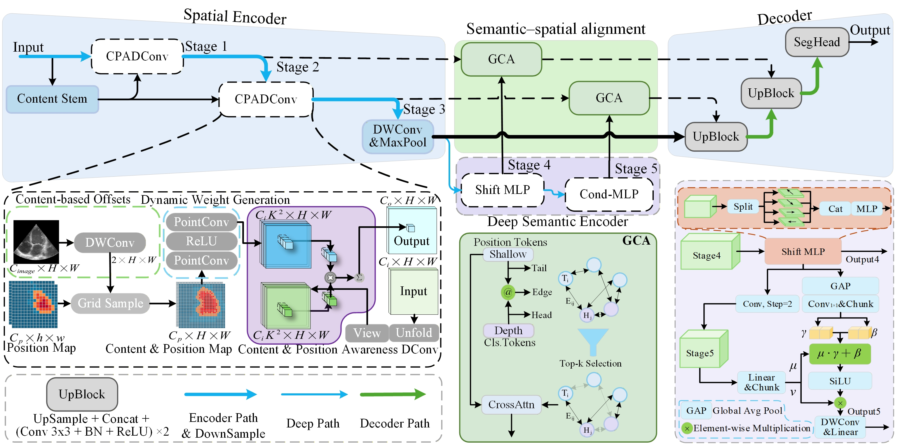

# HHANet

PyTorch implementation of HHANet for medical image segmentation, including Tiny and Base models.



## Installation

Python 3.10 is recommended. Install a PyTorch build suitable for your CUDA environment, then:

```bash
pip install -r requirements.txt
```

## Model

```python
from hhanet import build_hhanet

model = build_hhanet("tiny", num_classes=1)
model = build_hhanet("base", num_classes=4)
```

The complete model uses CPADConv, HM-MLP, and GCA. At 256 × 256, Tiny has approximately 0.89M parameters and 1.41G MACs; Base has approximately 8.59M parameters and 6.50G MACs.

## Training

The included training entry supports binary image segmentation. Prepare RGB images and binary masks (0 for background, 255 for foreground):

```text
data/MyDataset/
├── train/
│   ├── imgs/
│   └── masks/
├── val/
│   ├── imgs/
│   └── masks/
└── test/
    ├── imgs/
    └── masks/
```

Use matching filenames with `.png` extensions. Training, validation, and test splits must be prepared before running:

```bash
python train.py --variant tiny --dataset_dir ./data --dataset_name MyDataset \
    --num_classes 1 --epochs 300 --batch_size 8 --lr 1e-3 \
    --save_dir ./checkpoints/MyDataset_tiny
```

Replace `tiny` with `base` for the Base model. The entry uses AdamW, BCE + Dice loss, cosine learning-rate decay, and the augmentation defined in `dataset.py`. It validates after each epoch and evaluates the best validation-Dice checkpoint on the test split. This generic image entry does not implement the volume evaluation used for ACDC or Synapse.

## Checkpoints

Models are randomly initialized unless a checkpoint is provided. Weights are not bundled. To resume a checkpoint produced by this entry, add `--resume ./checkpoints/MyDataset_tiny/latest.pth`.

Existing HappyNet-format weights can be loaded with explicit key conversion:

```python
model = build_hhanet(
    "base", num_classes=4,
    pretrained="./weights/model.pth", legacy_ckpt=True,
)
```

The variant, class count, and positional-prior reference size must match the checkpoint. Loading checks all parameter keys and shapes.

## License

MIT; see [LICENSE](LICENSE). Third-party notices, where applicable, are retained in [NOTICE](NOTICE).
